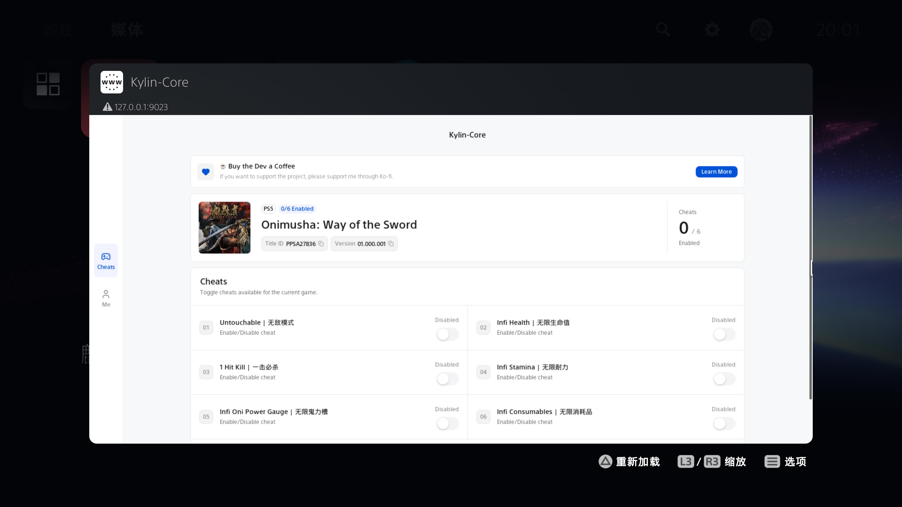

<p align="center">
  
</p>

<p align="center">
  <b>Kylin Core</b><br/>
  A homebrew cheat loader and real-time game modifier for PlayStation 5
</p>

<p align="center">
  <b>English</b>
  ·
  <a href="zh/README.md">简体中文</a>
</p>

<p align="center">
  <b><a href="#features">Features</a></b>
  ·
  <b><a href="#run">Run</a></b>
  ·
  <b><a href="#cheat-files">Cheat files</a></b>
  ·
  <b><a href="#web-ui">Web UI</a></b>
  ·
  <b><a href="#runtime-data">Runtime data</a></b>
  ·
  <b><a href="#troubleshooting">Troubleshooting</a></b>
  ·
  <b><a href="#support">Support</a></b>
  ·
  <b><a href="#credits">Credits</a></b>
</p>

---

<p align="center">
  <a href="LICENSE"></a>
  <a href="https://github.com/aydencharles/kylin-core-release/releases/latest"></a>
  
  
</p>

<p align="center">
  Kylin Core ships as a single ELF. The payload boots a background daemon,<br/>
  registers its own home-screen tile, detects the running title, patches game<br/>
  memory on demand, and serves a local web UI on port <b>9023</b>.
</p>

<p align="center">
  
</p>

<br>

# Features

Kylin Core is a single-payload cheat tool for jailbroken PS5 consoles. It runs
as a persistent daemon instead of a one-shot loader.

- **Real-time cheat toggle** — enable or disable a cheat while the game is running; the patch is applied or reverted immediately
- **Automatic game detection** — the daemon resolves the running title by itself, so no manual title ID is needed
- **Four cheat formats** — `.json`, `.shn`, `.mc4`, and `.ShnExt`, all loaded from a single flat directory
- **Hot reload** — cheat file edits apply immediately, with no restart
- **Built-in web UI** — served straight from the payload on port `9023` and opened by the home-screen tile
- **Home-screen tile** — the tile is registered automatically under the **Media** section of the home screen
- **Game media** — the UI streams the installed title's icon and hero art through the daemon
- **System notifications** — the daemon reports startup, ready, stop, and game launch through PS5 notifications
- **Single-tool distribution** — no `ps5debug-NG`, no extra modules, no additional runtime dependencies
- **Stable in-game operation** — no freeze on APR-protected titles

The web UI is localized in **简体中文**, **English**, and **한국어**.

<br>

# Run

### Requirements

1. A jailbroken PS5 with a working ELF loader
2. [PS5 Payload Manager (PLDMGR)](https://github.com/itsPLK/ps5-payload-manager) installed on the console

### Install

1. Load `kylin-core.elf` with **PS5 Payload Manager (PLDMGR)**.
2. Wait for the ready notification. The **Kylin Core** tile is under **Media** on the home screen.
3. Launch **Kylin Core** from the home screen.

> [!IMPORTANT]
> Load `kylin-core.elf` through PLDMGR **before** opening the tile. The tile is
> only a browser launcher pointing at `http://127.0.0.1:9023/`; if the daemon is
> not running, the UI has nothing to load.

### Compatibility

| Target | Status |
| --- | --- |
| PS4 games running on PS5 | Supported |
| PS5 native games | Supported |
| PS5 games with APR | Supported |
| Firmware | Jailbroken consoles on **4.0.3 through 13.60** |
| Cheat formats | `.json` · `.shn` · `.mc4` · `.ShnExt` |

<br>

# Cheat files

Cheat files live in one directory and follow one naming rule:

```text
/data/kylin/cheats/<TITLE_ID>_<VERSION>.json
/data/kylin/cheats/<TITLE_ID>_<VERSION>.shn
/data/kylin/cheats/<TITLE_ID>_<VERSION>.mc4
/data/kylin/cheats/<TITLE_ID>_<VERSION>.ShnExt
```

- The directory is flat. Subfolders are not scanned.
- `<TITLE_ID>` is the running title's ID, for example `PPSA00001`.
- `<VERSION>` is the running title's version with anything outside `0-9`, `A-Z`, `a-z`, `.`, `_`, and `-` replaced by `_`, so a version of `01.000.000` stays `01.000.000`.
- One file is resolved per title, in the order `.json` → `.shn` → `.mc4` → `.ShnExt`. The first match wins, so a `.json` file shadows an `.shn` file for the same title and version.

Editing a cheat file takes effect right away, even mid-session — no restart.

<br>

# Web UI

The daemon serves its own frontend, embedded in the ELF.

```text
http://127.0.0.1:9023/      on the console (what the launcher tile opens)
http://<console-ip>:9023/   from any device on the same network
```

| Page | What it does |
| --- | --- |
| Cheats | Lists the running title and its cheats; toggles them individually |
| Game | Shows the detected title, its icon and hero art, and the resolved cheat file |
| Profile | Current user and avatar |
| Settings | UI language and theme |
| Logs | Reads and downloads the daemon log |

The UI can also be pointed at a console manually from its connect screen, which
is how it is used when served from a development build rather than from the
daemon.

<br>

# Runtime data

| Path | Purpose |
| --- | --- |
| `/data/kylin/` | Daemon data root, created on startup |
| `/data/kylin/cheats/` | Cheat files, flat directory |
| `/data/kylin/logs/kylin-core.log` | Daemon log, rotated at 256 KiB with 3 files kept |
| `/tmp/kylin-core.log` | Log fallback used when the data root is not writable |

<br>

# Repository layout

```text
.
├── assets/          Project artwork and screenshots
├── guide/           Installation guide
├── zh/              Simplified Chinese README and installation guide
├── LICENSE
└── README.md
```

<br>

# Troubleshooting

1. **The tile opens a blank page or a browser error.** The daemon is not running. Load `kylin-core.elf` through PLDMGR first, wait for the ready notification, then reopen the tile.
2. **There is no Kylin Core tile on the home screen.** The tile is registered automatically when the payload starts. Confirm the payload reached the ready state, then check `/data/kylin/logs/kylin-core.log`.
3. **The daemon never becomes ready.** Confirm the payload matches your firmware and that PLDMGR reported a successful load. Check `/data/kylin/logs/kylin-core.log`, or `/tmp/kylin-core.log` if the data root was not writable.
4. **No game is detected.** Start the game first and let it reach the main menu, then refresh the Cheats page. The daemon only reports titles that are actually running.
5. **The cheat list is empty.** Check the filename. It must be `<TITLE_ID>_<VERSION>.json`, `.shn`, `.mc4`, or `.ShnExt`, directly inside `/data/kylin/cheats` with no subfolder.
6. **A cheat is listed but does nothing.** Cheats are only as good as their implementation, and some depend on a specific game version. Verify the version segment of the filename against the running title.

When reporting a problem, include the firmware version, the game title ID and
version, the daemon log, and the steps that reproduce it.

<br>

# Support

<a href="https://ko-fi.com/0xp0co"></a>

If Kylin Core is useful to you, consider supporting its continued development.
Thank you.

<br>

# Credits

Kylin Core exists because of the PS5 homebrew and reverse-engineering community.

### Used or embedded

- [PS5 Payload SDK](https://github.com/ps5-payload-dev/sdk) — Prospero toolchain, target headers, and runtime used to build the payload
- [PS5 Payload Manager (PLDMGR)](https://github.com/itsPLK/ps5-payload-manager) — itsplk; the ELF loader used to send the payload to the console; not shipped in the release
- [CivetWeb](https://github.com/civetweb/civetweb) — the embedded web server that serves the UI
- [cJSON](https://github.com/DaveGamble/cJSON) — JSON parsing and serialization
- MC4 helper subset — `base64.c` carries a BSD notice by Jouni Malinen; `aes.c` is derived from [tiny-AES-c](https://github.com/kokke/tiny-AES-c) by kokke
- [miniz](https://github.com/richgel999/miniz) — deflate and archive handling
- [SHA-256](https://github.com/B-Con/crypto-algorithms) — Brad Conte; hashing used by the daemon
- [Keystone](https://github.com/keystone-engine/keystone) — assembler used by the cheat engine

<br>

# License

This project is licensed under the [MIT License](LICENSE).
Third-party components retain their respective licenses and notices.

> Kylin Core is an unofficial homebrew project and is not affiliated with Sony Interactive Entertainment.
> Use it only on hardware you own and at your own risk. No warranty is provided.
