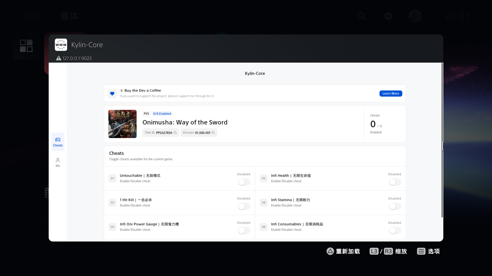

<p align="center">
  
</p>

<p align="center">
  <b>Kylin Core</b>（麒麟核心）<br/>
  面向 PlayStation 5 的自制金手指加载器与实时游戏修改工具
</p>

<p align="center">
  <a href="../README.md">English</a>
  ·
  <b>简体中文</b>
</p>

<p align="center">
  <b><a href="#功能">功能</a></b>
  ·
  <b><a href="#运行">运行</a></b>
  ·
  <b><a href="#金手指文件">金手指文件</a></b>
  ·
  <b><a href="#网页界面">网页界面</a></b>
  ·
  <b><a href="#运行时数据">运行时数据</a></b>
  ·
  <b><a href="#故障排查">故障排查</a></b>
  ·
  <b><a href="#赞助">赞助</a></b>
  ·
  <b><a href="#致谢">致谢</a></b>
</p>

---

<p align="center">
  <a href="../LICENSE"></a>
  <a href="https://github.com/aydencharles/kylin-core-release/releases/latest"></a>
  
  
</p>

<p align="center">
  Kylin Core 是一个单文件 ELF。payload 启动常驻守护进程，自行注册主屏幕入口，<br/>
  自动识别当前运行的游戏，按需改写游戏内存，并在 <b>9023</b> 端口提供本地网页界面。
</p>

<p align="center">
  
</p>

<br>

# 功能

Kylin Core 是面向已越狱 PS5 的单 payload 金手指工具。它以常驻守护进程的方式
运行，而不是一次性的加载器。

- **实时开关金手指** — 游戏运行中随时启用或关闭某条金手指，内存改写立即生效或撤销
- **自动识别游戏** — 守护进程自己解析当前运行的游戏，无需手动填写 Title ID
- **四种金手指格式** — `.json`、`.shn`、`.mc4`、`.ShnExt`，统一放在同一个扁平目录
- **热重载** — 金手指文件改动即刻生效，无需重启
- **内置网页界面** — 直接由 payload 提供，在 `9023` 端口服务，由主屏幕入口打开
- **主屏幕入口** — 入口自动注册在主屏幕的**媒体**分类下
- **游戏媒体** — 界面通过守护进程读取已安装游戏的图标与主视觉图
- **系统通知** — 守护进程通过 PS5 通知报告启动、就绪、停止和启动游戏等状态
- **单文件分发** — 不需要 `ps5debug-NG`，不需要额外模块，也没有其它运行时依赖
- **游戏内稳定运行** — 带 APR 保护的游戏不会卡死

网页界面提供 **简体中文**、**English**、**한국어** 三种语言。

<br>

# 运行

### 运行要求

1. 一台已越狱、且具备可用 ELF 加载器的 PS5
2. 主机上已安装 [PS5 Payload Manager (PLDMGR)](https://github.com/itsPLK/ps5-payload-manager)

### 安装

1. 用 **PS5 Payload Manager (PLDMGR)** 加载 `kylin-core.elf`。
2. 等待就绪通知。**Kylin Core** 入口就在主屏幕的**媒体**分类下。
3. 从主屏幕启动 **Kylin Core**。

> [!IMPORTANT]
> 打开入口之前，必须先用 PLDMGR 加载 `kylin-core.elf`。入口本身只是一个指向
> `http://127.0.0.1:9023/` 的浏览器启动器；守护进程没跑起来时，界面自然没有内容可加载。

### 兼容性

| 目标 | 状态 |
| --- | --- |
| 在 PS5 上运行的 PS4 游戏 | 支持 |
| PS5 原生游戏 | 支持 |
| 带 APR 保护的 PS5 游戏 | 支持 |
| 系统固件 | 已越狱主机的 **4.0.3 至 13.60** |
| 金手指格式 | `.json` · `.shn` · `.mc4` · `.ShnExt` |

<br>

# 金手指文件

金手指文件放在同一个目录，命名遵循同一条规则：

```text
/data/kylin/cheats/<TITLE_ID>_<VERSION>.json
/data/kylin/cheats/<TITLE_ID>_<VERSION>.shn
/data/kylin/cheats/<TITLE_ID>_<VERSION>.mc4
/data/kylin/cheats/<TITLE_ID>_<VERSION>.ShnExt
```

- 该目录是扁平的，不会扫描子文件夹。
- `<TITLE_ID>` 是当前运行游戏的 ID，例如 `PPSA00001`。
- `<VERSION>` 是当前运行游戏的版本号，其中 `0-9`、`A-Z`、`a-z`、`.`、`_`、`-` 之外的字符会被替换成 `_`；所以 `01.000.000` 保持不变。
- 同一游戏只解析一个文件，顺序为 `.json` → `.shn` → `.mc4` → `.ShnExt`，先命中者生效。也就是说，同一游戏同一版本下，`.json` 会屏蔽掉 `.shn`。

游戏中直接编辑金手指文件即刻生效，不需要重启。

<br>

# 网页界面

守护进程自带前端，界面资源直接嵌在 ELF 里。

```text
http://127.0.0.1:9023/      在主机本机上（主屏幕入口打开的就是这个地址）
http://<主机IP>:9023/       同一网络下任意设备均可访问
```

| 页面 | 作用 |
| --- | --- |
| 金手指 | 列出当前运行的游戏及其金手指，可逐条开关 |
| 游戏 | 显示识别到的游戏、图标与主视觉图，以及实际解析到的金手指文件 |
| 我的 | 当前用户与头像 |
| 设置 | 界面语言与主题 |
| 日志 | 查看并下载守护进程日志 |

界面也可以从它的连接页手动指定主机地址，这就是它被独立部署（而不是由守护进程
提供）时的使用方式。

<br>

# 运行时数据

| 路径 | 用途 |
| --- | --- |
| `/data/kylin/` | 守护进程数据根目录，启动时创建 |
| `/data/kylin/cheats/` | 金手指文件，扁平目录 |
| `/data/kylin/logs/kylin-core.log` | 守护进程日志，达到 256 KiB 轮转，保留 3 个文件 |
| `/tmp/kylin-core.log` | 数据根目录不可写时使用的日志回退路径 |

<br>

# 仓库结构

```text
.
├── assets/          项目图片与截图
├── guide/           安装指南
├── zh/              简体中文 README 与安装指南
├── LICENSE
└── README.md
```

<br>

# 故障排查

1. **入口打开后是空白页或浏览器报错。** 守护进程没在运行。先用 PLDMGR 加载 `kylin-core.elf`，等就绪通知出现，再重新打开入口。
2. **主屏幕上没有 Kylin Core 入口。** 入口在 payload 启动时自动注册。先确认 payload 进入了就绪状态，再看 `/data/kylin/logs/kylin-core.log`。
3. **守护进程一直没有就绪。** 确认这份 payload 与你的固件匹配，且 PLDMGR 报告加载成功。查看 `/data/kylin/logs/kylin-core.log`；如果数据根目录不可写，则看 `/tmp/kylin-core.log`。
4. **识别不到游戏。** 先启动游戏并进到主菜单，再刷新金手指页面。守护进程只会报告真正在运行的游戏。
5. **金手指列表是空的。** 检查文件名。必须是 `<TITLE_ID>_<VERSION>.json`、`.shn`、`.mc4` 或 `.ShnExt`，并且直接放在 `/data/kylin/cheats` 下，不能有子目录。
6. **金手指能列出来但不起作用。** 金手指的实际效果取决于其实现质量，部分还依赖特定的游戏版本。请核对文件名里的版本段与当前运行的游戏版本是否一致。

反馈问题时，请附上固件版本、游戏的 Title ID 与版本、守护进程日志，以及复现步骤。

<br>

# 赞助

<a href="https://ko-fi.com/0xp0co"></a>

如果 Kylin Core 对你有用，欢迎支持它的持续开发。谢谢。

<br>

# 致谢

Kylin Core 离不开 PS5 自制软件与逆向工程社区。

### 实际使用或内嵌

- [PS5 Payload SDK](https://github.com/ps5-payload-dev/sdk) — 构建 payload 所用的 Prospero 工具链、目标头文件与运行库
- [PS5 Payload Manager (PLDMGR)](https://github.com/itsPLK/ps5-payload-manager) — itsplk；用于把 payload 发送到主机的 ELF 加载器，不随发布包分发
- [CivetWeb](https://github.com/civetweb/civetweb) — 提供网页界面的内嵌 Web 服务
- [cJSON](https://github.com/DaveGamble/cJSON) — JSON 解析与序列化
- MC4 辅助子集 — `base64.c` 带有 Jouni Malinen 的 BSD 声明；`aes.c` 派生自 kokke 的 [tiny-AES-c](https://github.com/kokke/tiny-AES-c)
- [miniz](https://github.com/richgel999/miniz) — deflate 与归档处理
- [SHA-256](https://github.com/B-Con/crypto-algorithms) — Brad Conte；守护进程使用的哈希实现
- [Keystone](https://github.com/keystone-engine/keystone) — 金手指引擎使用的汇编器

<br>

# 许可证

本项目基于 [MIT License](../LICENSE) 发布。
第三方组件保留各自的许可证与声明。

> Kylin Core 是非官方自制项目，与 Sony Interactive Entertainment 无关。
> 请只在你自己的主机上使用，风险自负。本项目不提供任何担保。
